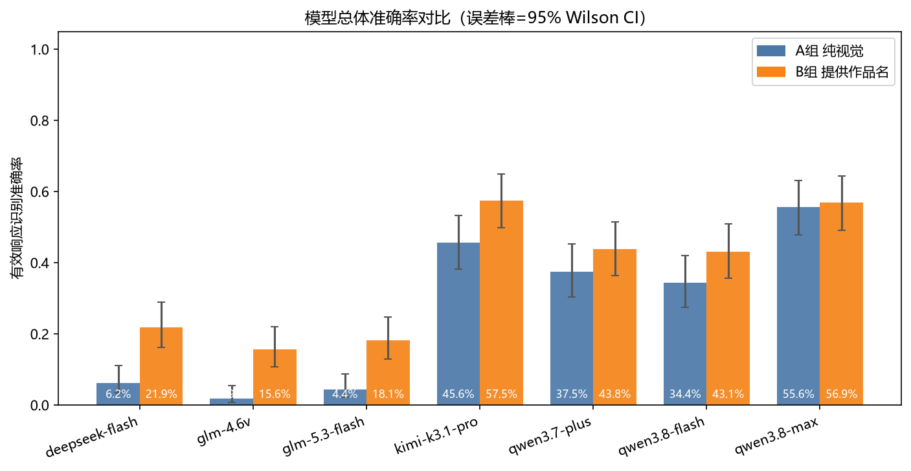
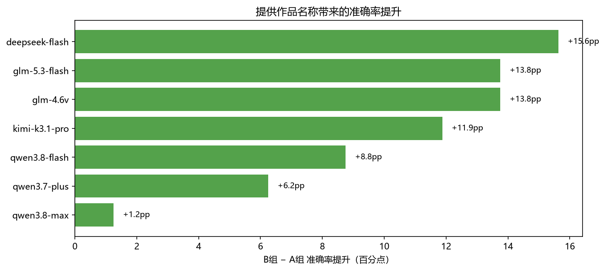
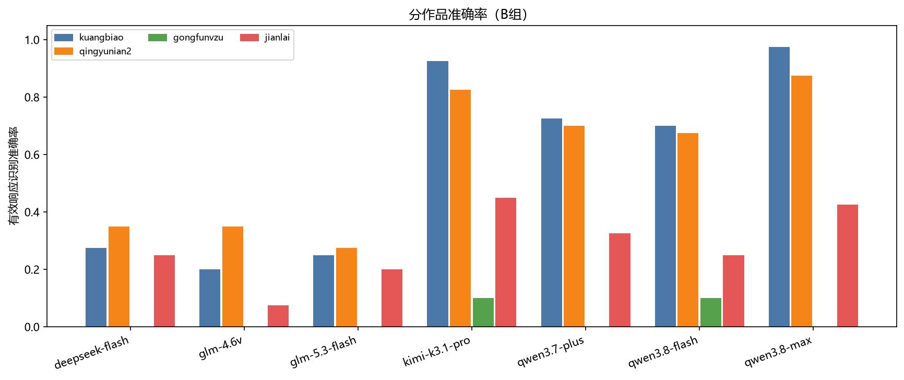
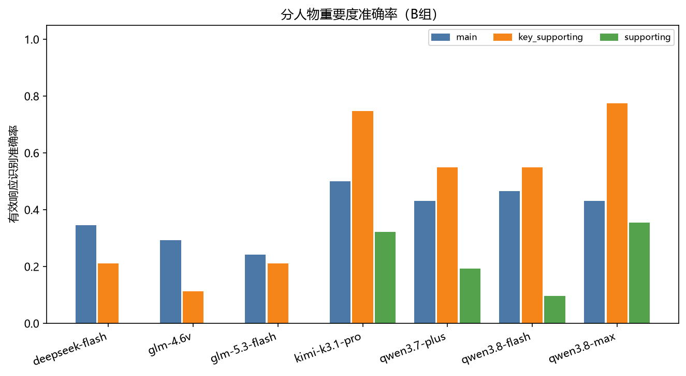
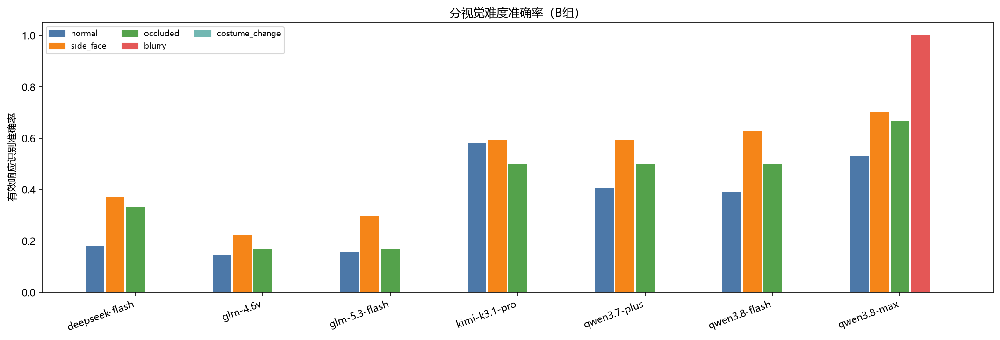
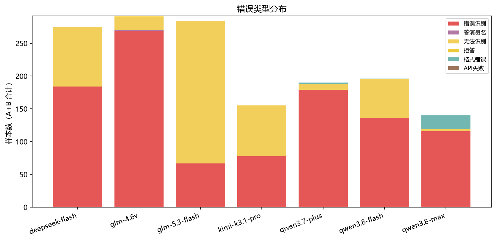

# 国产多模态大模型影视角色识别评测报告

> 可移植报告版本。返回[汇总页](../index.html)，查看[累计20项标签修订与2张替换摘要](../annotation_changes.json)及[最终160张样本清单](../../../data/final/dataset.json)。新增3项为用户直接纠正剑来0038/0039/0040为于禄；原输入快照、完整审计与截图错误页保留本地。统计已用gt_revision_02离线重评，原响应未变、未新增调用。

- Run ID：`run_20261113_final_practical`
- Prompt 版本：`v1`
- 数据集快照哈希：`921e13f7f0ac1b72…`
- 运行时间：2026-11-13T01:55:50+00:00
- 标签：Final cohort (saved-response assembly)
- 参与模型数：7；样本数：160

## 1. 数据集概览

| 作品 | 样本数 | 主角 | 重要配角 | 普通配角 | 复杂画面 | 多人同框 |
|---|---|---|---|---|---|---|
| kuangbiao | 40 | 5 | 2 | 4 | 3 | 26 |
| qingyunian2 | 40 | 4 | 8 | 1 | 8 | 19 |
| gongfunvzu | 40 | 13 | 1 | 0 | 2 | 24 |
| jianlai | 40 | 0 | 6 | 3 | 5 | 26 |

## 2. 模型总体排行榜（核心指标：有效响应识别准确率，95% Wilson CI）

> 有效响应 = 计划样本 − API失败 − 未执行；拒答与格式错误均计入分母（模型行为）。
> 端到端正确率与 API 失败率见第 3 节双口径表。

| 模型 | 厂商/档位 | A组准确率 | B组准确率 | B−A 提升 | A/B 配对检验 |
|---|---|---|---|---|---|
| Kimi K3.1 Pro | Kimi/flagship | 45.6% [38.1%–53.4%] | 57.5% [49.8%–64.9%] | +11.9pp | p=0.000（binomial_exact(scipy)） |
| Qwen3.8-Max | Qwen/flagship | 55.6% [47.9%–63.1%] | 56.9% [49.1%–64.3%] | +1.2pp | p=0.500（binomial_exact(scipy)） |
| Qwen3.7-Plus | Qwen/standard | 37.5% [30.4%–45.2%] | 43.8% [36.3%–51.5%] | +6.2pp | p=0.052（binomial_exact(scipy)） |
| Qwen3.8-Flash | Qwen/flash | 34.4% [27.5%–42.0%] | 43.1% [35.7%–50.9%] | +8.8pp | p=0.013（binomial_exact(scipy)） |
| DeepSeek Flash (V4.1-Flash-1017) | DeepSeek/flash | 6.2% [3.4%–11.1%] | 21.9% [16.2%–28.9%] | +15.6pp | p=0.000（binomial_exact(scipy)） |
| GLM-5.3-Flash | GLM/flagship | 4.4% [2.1%–8.8%] | 18.1% [12.9%–24.8%] | +13.8pp | p=0.000（binomial_exact(scipy)） |
| GLM-4.6V | GLM/standard | 1.9% [0.6%–5.4%] | 15.6% [10.8%–22.0%] | +13.8pp | p=0.000（binomial_exact(scipy)） |

## 3. 双口径指标（调整 5：网络故障不得扭曲模型能力评价）

| 模型 | 实验 | 计划 | 有效响应 | 正确 | 端到端正确率 | 有效响应准确率 | API失败率 |
|---|---|---|---|---|---|---|---|
| DeepSeek Flash (V4.1-Flash-1017) | A | 160 | 160 | 10 | 6.2% | 6.2% | 0.0% |
| DeepSeek Flash (V4.1-Flash-1017) | B | 160 | 160 | 35 | 21.9% | 21.9% | 0.0% |
| GLM-4.6V | A | 160 | 160 | 3 | 1.9% | 1.9% | 0.0% |
| GLM-4.6V | B | 160 | 160 | 25 | 15.6% | 15.6% | 0.0% |
| GLM-5.3-Flash | A | 160 | 160 | 7 | 4.4% | 4.4% | 0.0% |
| GLM-5.3-Flash | B | 160 | 160 | 29 | 18.1% | 18.1% | 0.0% |
| Kimi K3.1 Pro | A | 160 | 160 | 73 | 45.6% | 45.6% | 0.0% |
| Kimi K3.1 Pro | B | 160 | 160 | 92 | 57.5% | 57.5% | 0.0% |
| Qwen3.7-Plus | A | 160 | 160 | 60 | 37.5% | 37.5% | 0.0% |
| Qwen3.7-Plus | B | 160 | 160 | 70 | 43.8% | 43.8% | 0.0% |
| Qwen3.8-Flash | A | 160 | 160 | 55 | 34.4% | 34.4% | 0.0% |
| Qwen3.8-Flash | B | 160 | 160 | 69 | 43.1% | 43.1% | 0.0% |
| Qwen3.8-Max | A | 160 | 160 | 89 | 55.6% | 55.6% | 0.0% |
| Qwen3.8-Max | B | 160 | 160 | 91 | 56.9% | 56.9% | 0.0% |

## 4. 结果分类明细

| 模型 | 实验 | 正确 | 错误识别 | 答演员名 | 无法识别 | 拒答 | 格式错误 | API失败 | 未执行 |
|---|---|---|---|---|---|---|---|---|---|
| DeepSeek Flash (V4.1-Flash-1017) | A | 10 | 96 | 0 | 54 | 0 | 0 | 0 | 0 |
| DeepSeek Flash (V4.1-Flash-1017) | B | 35 | 88 | 0 | 37 | 0 | 0 | 0 | 0 |
| GLM-4.6V | A | 3 | 153 | 1 | 3 | 0 | 0 | 0 | 0 |
| GLM-4.6V | B | 25 | 116 | 0 | 19 | 0 | 0 | 0 | 0 |
| GLM-5.3-Flash | A | 7 | 21 | 0 | 132 | 0 | 0 | 0 | 0 |
| GLM-5.3-Flash | B | 29 | 46 | 0 | 85 | 0 | 0 | 0 | 0 |
| Kimi K3.1 Pro | A | 73 | 49 | 0 | 38 | 0 | 0 | 0 | 0 |
| Kimi K3.1 Pro | B | 92 | 29 | 0 | 39 | 0 | 0 | 0 | 0 |
| Qwen3.7-Plus | A | 60 | 92 | 0 | 6 | 0 | 2 | 0 | 0 |
| Qwen3.7-Plus | B | 70 | 87 | 0 | 3 | 0 | 0 | 0 | 0 |
| Qwen3.8-Flash | A | 55 | 68 | 0 | 36 | 0 | 1 | 0 | 0 |
| Qwen3.8-Flash | B | 69 | 68 | 0 | 23 | 0 | 0 | 0 | 0 |
| Qwen3.8-Max | A | 89 | 64 | 0 | 0 | 0 | 7 | 0 | 0 |
| Qwen3.8-Max | B | 91 | 52 | 0 | 3 | 0 | 14 | 0 | 0 |

## 5. 分作品准确率（有效响应口径）

| 模型 | kuangbiao | qingyunian2 | gongfunvzu | jianlai |
|---|---|---|---|---|
| DeepSeek Flash (V4.1-Flash-1017) | 27.5% | 35.0% | 0.0% | 25.0% |
| GLM-4.6V | 20.0% | 35.0% | 0.0% | 7.5% |
| GLM-5.3-Flash | 25.0% | 27.5% | 0.0% | 20.0% |
| Kimi K3.1 Pro | 92.5% | 82.5% | 10.0% | 45.0% |
| Qwen3.7-Plus | 72.5% | 70.0% | 0.0% | 32.5% |
| Qwen3.8-Flash | 70.0% | 67.5% | 10.0% | 25.0% |
| Qwen3.8-Max | 97.5% | 87.5% | 0.0% | 42.5% |

## 6. 分人物重要度准确率（B组）

| 模型 | main | key_supporting | supporting |
|---|---|---|---|
| DeepSeek Flash (V4.1-Flash-1017) | 34.5% | 21.1% | 0.0% |
| GLM-4.6V | 29.3% | 11.3% | 0.0% |
| GLM-5.3-Flash | 24.1% | 21.1% | 0.0% |
| Kimi K3.1 Pro | 50.0% | 74.6% | 32.3% |
| Qwen3.7-Plus | 43.1% | 54.9% | 19.4% |
| Qwen3.8-Flash | 46.6% | 54.9% | 9.7% |
| Qwen3.8-Max | 43.1% | 77.5% | 35.5% |

## 7. 分视觉难度准确率（B组）

| 模型 | normal | side_face | occluded | blurry | costume_change |
|---|---|---|---|---|---|
| DeepSeek Flash (V4.1-Flash-1017) | 18.3% | 37.0% | 33.3% | 0.0% | — |
| GLM-4.6V | 14.3% | 22.2% | 16.7% | 0.0% | — |
| GLM-5.3-Flash | 15.9% | 29.6% | 16.7% | 0.0% | — |
| Kimi K3.1 Pro | 57.9% | 59.3% | 50.0% | 0.0% | — |
| Qwen3.7-Plus | 40.5% | 59.3% | 50.0% | 0.0% | — |
| Qwen3.8-Flash | 38.9% | 63.0% | 50.0% | 0.0% | — |
| Qwen3.8-Max | 53.2% | 70.4% | 66.7% | 100.0% | — |

## 8. 多人同框 vs 单人画面（B组）

| 模型 | 单人/主体 | 多人同框 |
|---|---|---|
| DeepSeek Flash (V4.1-Flash-1017) | 29.2% | 16.8% |
| GLM-4.6V | 23.1% | 10.5% |
| GLM-5.3-Flash | 23.1% | 14.7% |
| Kimi K3.1 Pro | 56.9% | 57.9% |
| Qwen3.7-Plus | 50.8% | 38.9% |
| Qwen3.8-Flash | 46.2% | 41.1% |
| Qwen3.8-Max | 66.2% | 50.5% |

## 9. 按角色统计（防高频角色掩盖短板）

| 模型 | 实验 | 角色宏平均准确率 | 覆盖角色数 | 最弱角色（准确率最低的前 5） |
|---|---|---|---|---|
| DeepSeek Flash (V4.1-Flash-1017) | A | 8.2% | 39 | 桑文 0/1；三皇子 0/1；侯公公 0/1；范无救 0/1；范建 0/1 |
| DeepSeek Flash (V4.1-Flash-1017) | B | 23.8% | 39 | 桑文 0/1；三皇子 0/1；侯公公 0/1；范无救 0/1；龚开疆 0/2 |
| GLM-4.6V | A | 3.2% | 39 | 桑文 0/1；三皇子 0/1；侯公公 0/1；范无救 0/1；范建 0/1 |
| GLM-4.6V | B | 20.9% | 39 | 桑文 0/1；三皇子 0/1；侯公公 0/1；范无救 0/1；龚开疆 0/2 |
| GLM-5.3-Flash | A | 4.3% | 39 | 桑文 0/1；三皇子 0/1；侯公公 0/1；范无救 0/1；范建 0/1 |
| GLM-5.3-Flash | B | 19.9% | 39 | 桑文 0/1；三皇子 0/1；侯公公 0/1；范无救 0/1；范建 0/1 |
| Kimi K3.1 Pro | A | 48.8% | 39 | 三皇子 0/1；侯公公 0/1；范无救 0/1；范建 0/1；孖八 0/2 |
| Kimi K3.1 Pro | B | 61.5% | 39 | 侯公公 0/1；范无救 0/1；孖八 0/2；丧彪 0/2；师太 0/3 |
| Qwen3.7-Plus | A | 40.2% | 39 | 三皇子 0/1；侯公公 0/1；范无救 0/1；范建 0/1；龚开疆 0/2 |
| Qwen3.7-Plus | B | 44.4% | 39 | 三皇子 0/1；侯公公 0/1；范无救 0/1；范建 0/1；龚开疆 0/2 |
| Qwen3.8-Flash | A | 34.6% | 39 | 三皇子 0/1；侯公公 0/1；范无救 0/1；范建 0/1；龚开疆 0/2 |
| Qwen3.8-Flash | B | 40.2% | 39 | 三皇子 0/1；侯公公 0/1；范无救 0/1；范建 0/1；龚开疆 0/2 |
| Qwen3.8-Max | A | 59.4% | 39 | 三皇子 0/1；侯公公 0/1；范无救 0/1；范建 0/1；孖八 0/2 |
| Qwen3.8-Max | B | 60.0% | 39 | 三皇子 0/1；侯公公 0/1；范无救 0/1；范建 0/1；孖八 0/2 |

## 10. 同厂商档位对比（tier 仅为项目分组标签，性能以实测为准）

| 厂商 | 模型 | 档位标签 | A组 | B组 |
|---|---|---|---|---|
| DeepSeek | DeepSeek Flash (V4.1-Flash-1017) | flash | 6.2% | 21.9% |
| GLM | GLM-4.6V | standard | 1.9% | 15.6% |
| GLM | GLM-5.3-Flash | flagship | 4.4% | 18.1% |
| Kimi | Kimi K3.1 Pro | flagship | 45.6% | 57.5% |
| Qwen | Qwen3.7-Plus | standard | 37.5% | 43.8% |
| Qwen | Qwen3.8-Flash | flash | 34.4% | 43.1% |
| Qwen | Qwen3.8-Max | flagship | 55.6% | 56.9% |

## 11. 可视化图表

## 12. 公平性与参数差异记录

- **dataset_snapshot_path**：保留本地（未包含）：results/snapshots/run_20261113_final_practical/dataset.json
- **image_hash_manifest_path**：保留本地（未包含）：results/snapshots/run_20261113_final_practical/image_hashes.json
- **sample_ids**：['kuangbiao_0001', 'kuangbiao_0002', 'kuangbiao_0003', 'kuangbiao_0004', 'kuangbiao_0005', 'kuangbiao_0006', 'kuangbiao_0007', 'kuangbiao_0008', 'kuangbiao_0009', 'kuangbiao_0010', 'kuangbiao_0011', 'kuangbiao_0012', 'kuangbiao_0013', 'kuangbiao_0014', 'kuangbiao_0015', 'kuangbiao_0016', 'kuangbiao_0017', 'kuangbiao_0018', 'kuangbiao_0019', 'kuangbiao_0020', 'kuangbiao_0021', 'kuangbiao_0022', 'kuangbiao_0023', 'kuangbiao_0024', 'kuangbiao_0025', 'kuangbiao_0026', 'kuangbiao_0027', 'kuangbiao_0028', 'kuangbiao_0029', 'kuangbiao_0030', 'kuangbiao_0031', 'kuangbiao_0032', 'kuangbiao_0033', 'kuangbiao_0034', 'kuangbiao_0035', 'kuangbiao_0036', 'kuangbiao_0037', 'kuangbiao_0038', 'kuangbiao_0039', 'kuangbiao_0040', 'qingyunian2_0001', 'qingyunian2_0003', 'qingyunian2_0004', 'qingyunian2_0005', 'qingyunian2_0006', 'qingyunian2_0007', 'qingyunian2_0008', 'qingyunian2_0009', 'qingyunian2_0010', 'qingyunian2_0011', 'qingyunian2_0012', 'qingyunian2_0013', 'qingyunian2_0014', 'qingyunian2_0015', 'qingyunian2_0016', 'qingyunian2_0017', 'qingyunian2_0018', 'qingyunian2_0019', 'qingyunian2_0020', 'qingyunian2_0021', 'qingyunian2_0022', 'qingyunian2_0023', 'qingyunian2_0024', 'qingyunian2_0025', 'qingyunian2_0026', 'qingyunian2_0027', 'qingyunian2_0028', 'qingyunian2_0029', 'qingyunian2_0030', 'qingyunian2_0031', 'qingyunian2_0032', 'qingyunian2_0033', 'qingyunian2_0034', 'qingyunian2_0035', 'qingyunian2_0036', 'qingyunian2_0038', 'qingyunian2_0039', 'qingyunian2_0040', 'qingyunian2_0041', 'qingyunian2_0042', 'gongfunvzu_0001', 'gongfunvzu_0002', 'gongfunvzu_0003', 'gongfunvzu_0004', 'gongfunvzu_0005', 'gongfunvzu_0006', 'gongfunvzu_0007', 'gongfunvzu_0008', 'gongfunvzu_0009', 'gongfunvzu_0010', 'gongfunvzu_0011', 'gongfunvzu_0012', 'gongfunvzu_0013', 'gongfunvzu_0014', 'gongfunvzu_0015', 'gongfunvzu_0016', 'gongfunvzu_0017', 'gongfunvzu_0018', 'gongfunvzu_0019', 'gongfunvzu_0020', 'gongfunvzu_0021', 'gongfunvzu_0022', 'gongfunvzu_0023', 'gongfunvzu_0024', 'gongfunvzu_0025', 'gongfunvzu_0026', 'gongfunvzu_0027', 'gongfunvzu_0028', 'gongfunvzu_0029', 'gongfunvzu_0030', 'gongfunvzu_0031', 'gongfunvzu_0032', 'gongfunvzu_0033', 'gongfunvzu_0034', 'gongfunvzu_0035', 'gongfunvzu_0036', 'gongfunvzu_0037', 'gongfunvzu_0038', 'gongfunvzu_0039', 'gongfunvzu_0040', 'jianlai_0001', 'jianlai_0002', 'jianlai_0003', 'jianlai_0004', 'jianlai_0005', 'jianlai_0006', 'jianlai_0007', 'jianlai_0008', 'jianlai_0009', 'jianlai_0010', 'jianlai_0011', 'jianlai_0012', 'jianlai_0013', 'jianlai_0014', 'jianlai_0015', 'jianlai_0016', 'jianlai_0017', 'jianlai_0018', 'jianlai_0019', 'jianlai_0020', 'jianlai_0021', 'jianlai_0022', 'jianlai_0023', 'jianlai_0024', 'jianlai_0025', 'jianlai_0026', 'jianlai_0027', 'jianlai_0028', 'jianlai_0029', 'jianlai_0030', 'jianlai_0031', 'jianlai_0032', 'jianlai_0033', 'jianlai_0034', 'jianlai_0035', 'jianlai_0036', 'jianlai_0037', 'jianlai_0038', 'jianlai_0039', 'jianlai_0040']
- **prompt_version**：v1
- **marking**：目标人物以红色实线方框标注（PIL 绘制，线宽 max(3, 宽//200)），A/B 两组与所有模型使用同一函数与同一线宽规则；无 bbox 的样本不画框，提示词统一说明『无红框时识别画面主要人物』。
- **generation_params**：{'temperature': 0.1, 'max_tokens': 4096, 'note': 'K3.1固定temperature=1故不显式传；其余接受者统一0.1。可关闭型号关闭思考，K3.1/GLM5.3使用不可关闭的low思考；具体模式见per_model_notes。'}
### 各模型参数差异

- **deepseek-flash**：`extra_body={'thinking': {'type': 'disabled'}}`；传temperature=是；2026-11-13 预检默认思考耗尽4096预算而无正文；正式测试显式关闭思考， 与其他可关闭型号统一采用直接识别模式；原始预检单独留存。
- **glm-5.3-flash**：`extra_body={'thinking': {'type': 'enabled'}, 'reasoning_effort': 'low'}`；传temperature=是；思考不能关闭；本轮显式reasoning_effort=low，temperature=0.1；与可关闭思考的型号存在模式差异并如实记录。
- **glm-4.6v**：`extra_body={'thinking': {'type': 'disabled'}}`；传temperature=是；本轮显式关闭思考，采用直接识别模式。
- **qwen3.8-max**：`extra_body={'enable_thinking': False}`；传temperature=是；混合思考模型，统一关闭 thinking（enable_thinking=false）以保证各模型条件一致。
- **qwen3.7-plus**：`extra_body={'enable_thinking': False}`；传temperature=是；混合思考模型，统一关闭 thinking。
- **qwen3.8-flash**：`extra_body={'enable_thinking': False}`；传temperature=是；连通性检查中实测确认图片输入能力（推荐页与视觉文档均提及）。
- **kimi-k3.1-pro**：`extra_body={'reasoning_effort': 'low'}`；传temperature=否；官方模型列表已列 K3.1 Pro；2026-11-13 中国站连通性检查通过。 2026-11-13 实测接口只接受 temperature=1，故不显式传采样温度； K3.1 始终思考，本轮使用官方支持的low力度；与可关闭思考的型号存在模式差异。
- **image_encoding**：JPEG data-URL，长边≤1600，质量92（所有模型一致；详见各记录 image_meta）
- **tools_disabled**：不传 tools/tool_choice；不启用联网搜索
- **settings_snapshot**：{'retry': {'max_attempts': 4, 'backoff_base_seconds': 2.0, 'timeout_seconds': 120}, 'generation': {'temperature': 0.1, 'max_tokens': 4096}, 'collect': {'request_timeout_seconds': 15, 'max_images_per_work': 150, 'min_image_bytes': 10240, 'user_agent': 'Mozilla/5.0 (Windows NT 10.0; Win64; x64) AppleWebKit/537.36 (KHTML, like Gecko) Chrome/124.0 Safari/537.36'}, 'clean': {'min_width': 300, 'min_height': 200, 'phash_hamming_threshold': 8, 'allowed_formats': ['jpg', 'jpeg', 'png', 'webp']}, 'export': {'target_per_group': 8, 'target_per_work': 40}, 'scoring': {'fuzzy_review_threshold': 0.9, 'refusal_keywords': ['无法识别身份', '不能识别人脸', '无法识别人脸', '不进行人脸识别', '涉及隐私', '无法确认人物身份', '我不能识别']}, 'pilot': {'per_model_connectivity': 1, 'per_model_small': 10, 'per_work_formal': 10}, 'runner': {'concurrency': 8, 'per_model_concurrency': {'kimi-k3.1-pro': 1, 'glm-4.6v-flash': 1}, 'per_model_min_interval_seconds': {'kimi-k3.1-pro': 20.1, 'glm-4.6v-flash': 6.1}}, 'screening': {'grayscale_sat_mean': 0.05, 'grayscale_sat_p95': 0.12, 'poster_aspect_max': 0.85, 'odd_aspect_min': 1.3, 'odd_aspect_max': 2.45, 'white_border_frac': 0.6, 'white_border_threshold': 235, 'collage_peak_ratio': 3.0, 'collage_span_min': 0.85, 'collage_min_peaks': 2, 'collage_spacing_cv': 0.35, 'blocklist_domains': ['pixiv.net', 'pximg.net', 'civitai.com', 'lofter.com']}}
- **cohort_assembly**：{'kind': 'offline_response_reuse', 'source_run_ids': ['run_20261113_010640', 'run_20261113_010800', 'run_20261113_014628', 'run_20261113_015201'], 'source_runs': [{'run_id': 'run_20261113_010640', 'dataset_hash': '7eed2fb56b1d5d161a5168b898bd88b5', 'dataset_snapshot_path': '保留本地（未包含）：results/snapshots/run_20261113_010640/dataset.json', 'status': 'interrupted'}, {'run_id': 'run_20261113_010800', 'dataset_hash': '7eed2fb56b1d5d161a5168b898bd88b5', 'dataset_snapshot_path': '保留本地（未包含）：results/snapshots/run_20261113_010800/dataset.json', 'status': 'done'}, {'run_id': 'run_20261113_014628', 'dataset_hash': '582eb30343a802f12486899b6760e6ea', 'dataset_snapshot_path': '保留本地（未包含）：results/snapshots/run_20261113_014628/dataset.json', 'status': 'done'}, {'run_id': 'run_20261113_015201', 'dataset_hash': '582eb30343a802f12486899b6760e6ea', 'dataset_snapshot_path': '保留本地（未包含）：results/snapshots/run_20261113_015201/dataset.json', 'status': 'done'}], 'source_record_counts': {'run_20261113_010640': 1896, 'run_20261113_010800': 316, 'run_20261113_014628': 24, 'run_20261113_015201': 4}, 'source_records_by_run': {'run_20261113_010640': 1896, 'run_20261113_010800': 316, 'run_20261113_014628': 24, 'run_20261113_015201': 4}, 'imported_records': 2240, 'source_image_manifests': ['../provenance/input_image_hashes.json', '../provenance/final_image_hashes.json'], 'annotation_revision_path': '../annotation_changes.json', 'historical_image_digest_available': False, 'limitations': ['Historical raw requests contain image_meta, not image digests. Image reuse is checked against source snapshot paths/bboxes and frozen SHA256 manifests; these digests do not purport to be captured at historical request time.'], 'no_api_calls': True, 'last_assembled_at': '2026-11-13T01:55:50+00:00', 'actual_request_contracts': {'deepseek-flash': {'model': 'deepseek-flash', 'max_tokens': 4096, 'temperature': 0.1, 'extra_body': {'thinking': {'type': 'disabled'}}, 'tools': None}, 'glm-5.3-flash': {'model': 'glm-5.3-flash', 'max_tokens': 4096, 'temperature': 0.1, 'extra_body': {'thinking': {'type': 'enabled'}, 'reasoning_effort': 'low'}, 'tools': None}, 'glm-4.6v': {'model': 'glm-4.6v', 'max_tokens': 4096, 'temperature': 0.1, 'extra_body': {'thinking': {'type': 'disabled'}}, 'tools': None}, 'qwen3.8-max': {'model': 'qwen3.8-max', 'max_tokens': 4096, 'temperature': 0.1, 'extra_body': {'enable_thinking': False}, 'tools': None}, 'qwen3.7-plus': {'model': 'qwen3.7-plus', 'max_tokens': 4096, 'temperature': 0.1, 'extra_body': {'enable_thinking': False}, 'tools': None}, 'qwen3.8-flash': {'model': 'qwen3.8-flash', 'max_tokens': 4096, 'temperature': 0.1, 'extra_body': {'enable_thinking': False}, 'tools': None}, 'kimi-k3.1-pro': {'model': 'kimi-k3.1-pro', 'max_completion_tokens': 4096, 'temperature': None, 'extra_body': {'reasoning_effort': 'low'}, 'tools': None}}, 'excluded_models': [{'model_id': 'glm-4.6v-flash', 'reason': '按用户对实际响应速度和稳定性的关注排除；实测反复返回模型当前访问量过大，保留114项可用性记录，不作全量准确率排名。'}]}
- **scoring_profile_path**：保留本地（未包含）：results/benchmark_20261113/gt_revision_02/scoring_profile/profile.json
- **alias_evidence_audit_path**：保留本地（未包含）：results/benchmark_20261113/alias_evidence_audit.json
- **ground_truth_revision**：{'role_labels_corrected': 20, 'inputs_replaced': 2, 'unchanged_original_inputs': 158, 'role_revision_audit': '../annotation_changes.json', 'replacement_audit': '../annotation_changes.json', 'user_label_corrections': 3, 'latest_role_revision_audit': '../annotation_changes.json'}
- **excluded_unavailable_models**：[{'model_id': 'kimi-k2.5', 'error_type': 'model_not_found', 'error_message': '实测404，当前账号不可用；未参与正式比较。'}, {'model_id': 'kimi-k2.6', 'error_type': 'model_not_found', 'error_message': '实测404，当前账号不可用；未参与正式比较。'}, {'model_id': 'glm-4.6v-flash', 'error_type': 'excluded_after_availability_check', 'error_message': '反复返回模型访问量过大；114项部分测试101 HTTP成功、13最终API失败。按用户关注实际稳定性停止后续全量，未参与准确率比较。'}]
- **evaluation_snapshot_path**：保留本地（未包含）：results/snapshots/run_20261113_final_practical/evaluation_rev2.json
- **evaluation_dataset_hash**：921e13f7f0ac1b724d1fc33119de68f1
- **annotation_revision_path**：../annotation_changes.json

## 13. 人工复核记录

| 模型 | 实验 | 样本 | 改判为 | 备注 |
|---|---|---|---|---|
| kimi-k3.1-pro | B | gongfunvzu_0004 | 无法识别 | assistant逐条复核原文：仅凭该截图无法确认人物身份及其在片中的角色姓名；JSON明确is_uncertain=true、character_name=null，没有政策或隐私拒绝意图，应归普通无法识别。仅修正分类，不改变准确率、不重发API。 |

## 14. 实验结论

- 总体（B组）最佳：Kimi K3.1 Pro，有效响应准确率 57.5%。
- gongfunvzu 最佳（B组）：Kimi K3.1 Pro 10.0%
- jianlai 最佳（B组）：Kimi K3.1 Pro 45.0%
- kuangbiao 最佳（B组）：Qwen3.8-Max 97.5%
- qingyunian2 最佳（B组）：Qwen3.8-Max 87.5%
- 作品名称平均影响：+10.2pp（5/7 个模型达到统计显著 p<0.05）。
